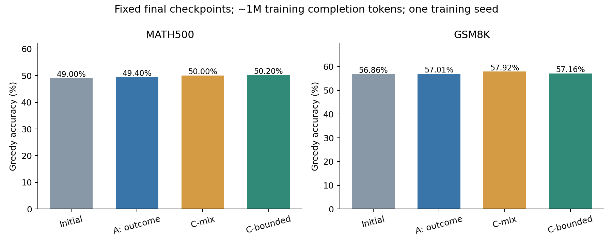

# Mathematical Reasoning RL: Outcome and Process Rewards

ECE285 三人课程研究项目：使用 **Qwen2.5-Math-1.5B、GRPO 与 LoRA**，研究过程奖励的失败模式和有界过程偏好。成员：Hongyi Ding、Jasmine Jiang、Yang Zeng。主要硬件：一张共享 A100 80GB。此仓库是截至 **2026-10-31** 的脱敏代码与结果审阅快照。

> **GPU 已按用户要求暂停，不自动恢复。** 新一轮约 6M 的三组续训尚未完成：A 保存至第 115 步（2,390,451 个生成 token），C-mix/C-bounded 保存至第 50 步。下表来自已完成的共同第 48 步评测，不能用暂停时不同步数的模型作公平比较。

## 先看这些

1. [当前方案与实验边界](docs/CURRENT_PLAN.txt) · [机器可读状态](results/current_status.json)
2. [统一四模型评测报告](execution/final_four_eval_20261029/REPORT.txt) · [统计结果](results/unified_four_model_1m.json)
3. [历史 6M A 的统一协议重评](execution/a6m_protocol_recheck_20261029/REPORT.txt) · [运行路径审计](execution/a6m_protocol_recheck_20261029/runtime_audit.json)
4. [暂停与完整断点记录](execution/abc_seed17_resume6m_v1_20261030/pause_receipt.json)

## 已完成结果

同一 V1 推理路径、冻结验答器、greedy decoding、输出上限 2,048 token；无投票或 PRM 重排。训练三组均为 seed17、第 48 步、相同题目顺序。`1M` 指约一百万个实际生成的 completion token，不是数据集大小。

| 模型 | 训练生成 token | MATH500 | GSM8K |
|---|---:|---:|---:|
| 初始模型 | 0 | 245/500 · 49.00% | 750/1319 · 56.86% |
| A：结果奖励 | 1,005,003 | 247/500 · 49.40% | 752/1319 · 57.01% |
| C-mix：结果＋过程奖励 | 1,001,853 | 250/500 · 50.00% | 764/1319 · 57.92% |
| C-bounded：有界过程偏好 | 1,009,017 | 251/500 · 50.20% | 754/1319 · 57.16% |

C-bounded−A：MATH500 **+0.80 pp，95% 配对区间 [−1.80, +3.40]**；GSM8K **+0.15 pp，[−1.44, +1.74]**。尚未建立稳定的准确率收益；区间覆盖题目抽样，不覆盖训练 seed 的不确定性。



历史 6M A（6,022,435 token、第 284 步）本轮 V1 重评为 **MATH500 55.00%、GSM8K 68.69%**。旧 54.00%/67.02% 记录使用 V0，引擎、缓存和调度配置共同改变，未精确复现。历史 6M A 与当前 1M A 也来自不同训练轨迹，不能把全部差值归因于训练 token 数。

## 具体改动

`y` 是固定规则给出的终答 0/1 奖励，`m` 是同一冻结、经 C 适配的 7B PRM 给出的最低步骤概率。**验证规则/PRM 提供奖励，GRPO 利用信号更新策略。**

| 组 | 训练信号 | 对照作用 |
|---|---|---|
| A | 对 `y` 作普通组内标准化 | 结果奖励基线 |
| C-mix | 对 `y + 0.2*m` 作组内标准化 | 检验直接混入过程分的行为 |
| C-bounded | `A_out + 0.2*y*(m − mean_correct(m))`，合成后不再标准化 | 保留结果优势，仅在正确回答内部加入有界过程偏好 |

精确定义见 [advantages.py](experiments/c_bounded_pilot_20261029_v2/advantages.py)。C-bounded 的过程项绝对值不超过 0.2；错答不会获得正优势，全错组为零。这是代数性质，**不等于已证明数学能力提升**。终答正确也不保证推导有效。我们不声称首创门控或新的 RL 范式。

C-mix 的约 1M 训练记录中有 82 条错答得到正优势，A/C-bounded 为 0，后两者受其定义约束。诊断区分 PRM 排序、组类型、分段和实际送入 loss 的 advantage；系数统计不被当作梯度贡献或因果证明。

## 工作状态与代码地图

| 内容 | 入口与状态 |
|---|---|
| 初始 GRPO、PRM runner、验证规则 | `training/`、`training_b/` |
| 独立分段/验答修复 | `experiments/reward_repair_*`；`legacy_snapshot/` 是真实依赖 |
| 历史只纠错 A/B，约 6M | [实现](experiments/ab_corrected_6m_seed17_20261022/) · [原始摘要](results/corrected_ab_seed17_6m.json) |
| A/B 提示词对照 | [已完成结果](results/prompt_comparison.json) |
| PURE 官方核查与单卡 pilot | [实现](experiments/pure_openrlhf_pilot_20261023/)；非完整论文配置复现 |
| 7B C/D 配对 PRM 适配 | [记录](execution/cd_prm_7b_pair_20261028/)；未进行 D 的完整 RL |
| 当前三组约 1M 配对训练 | [实现](experiments/c_bounded_pilot_20261029_v2/) · [证据](execution/c_bounded_triplet_seed17_1m_20261029/) |
| 初始模型和三组统一 V1 测试 | [完整报告与图表](execution/final_four_eval_20261029/) |
| 历史 6M A 按 V1 重评 | [完整报告与运行审计](execution/a6m_protocol_recheck_20261029/) |
| 当前三组约 6M 续训 | [独立版本](experiments/abc_seed17_resume6m_v1_20261030/)；**暂停、未完成** |
| 多 seed 稳定收益、过程有效性提升 | **尚未证实** |
| 原 proposal 与历史版本 | `proposal_neurips/`、`submission_snapshot_*`；当前状态以上方入口为准 |
| 逐题评测记录（无正文/完整 CoT） | [compact_predictions](results/compact_predictions/)；可复核正确数和配对差 |

目录保持原层级并保留失败/负结果。`execution/` 下包括配置、报告、审计、hash 和历史状态；较早记录不能作为实时状态。**不要直接执行历史 dispatch/controller/continuation。**

## 环境与复核

依赖见 [requirements.txt](training/requirements.txt)，历史环境锁见 [requirements.lock.txt](execution/baseline_seed17/requirements.lock.txt)。主要版本：torch 2.8.0、transformers 4.56.2、TRL 0.23.1、PEFT 0.17.1、vLLM 0.10.2。

无 GPU 的紧凑结果核对：

```bash
python tools/check_compact_results.py
```

HTML 报告可在 clone 后用浏览器打开；GitHub 默认展示其源代码。原始重算脚本及出处已保留，但完整重算还需要原环境的数据、权重、rollout 和配置。

## 分享范围与边界

- 本次上传代码、配置、报告、图表、聚合审计和紧凑逐题结果，保留已有 Git 历史。**权重/优化器断点、完整 rollout/CoT、原始数据、缓存及重复压缩包不进入 Git**；原始文件留在原位置。
- [SHARE_MANIFEST.json](SHARE_MANIFEST.json) 记录纳入/排除原因与原始/分享 hash。脱敏仅在分享副本进行；历史 release/receipt 的 hash 对应原实验文件，不能直接认证脱敏后的源码。
- 服务器地址、SSH 目标和个人本机路径替换为示例值；不含密钥或访问令牌。仓库没有自动训练工作流。
- 发布不恢复任何训练或推理。后续 GPU 使用、评测或预算扩展均需新的明确授权。

## 相关方法与上游来源

- [DeepSeekMath / GRPO](https://arxiv.org/abs/2402.03300)
- [PURE](https://arxiv.org/abs/2504.15275) / [官方代码](https://github.com/CJReinforce/PURE)
- [PAPO](https://arxiv.org/abs/2603.26535)：正确子集过程优势的相关先行工作。
- [ProcessBench](https://arxiv.org/abs/2412.06559)

第三方来源与许可边界见 [THIRD_PARTY_NOTICES.md](THIRD_PARTY_NOTICES.md)。个人贡献以实际代码与实验记录为准。
